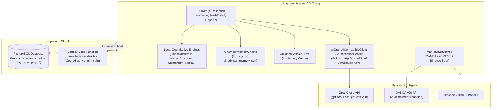
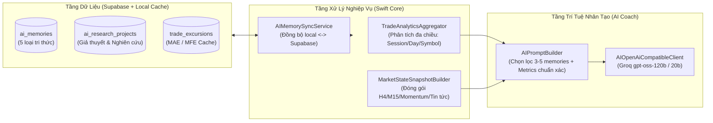

# TRADEJOURNAL AI COACH — BÁO CÁO KIỂM TOÁN HỆ THỐNG HIỆN TẠI (PHASE 0 AUDIT)
## Đánh giá hiện trạng, phân tích khoảng cách và kiến trúc thay đổi tối thiểu (Minimal-Diff Architecture)

**Dự án:** TradeJournal Native iOS & Cloud Synchronization  
**Ngày thực hiện kiểm toán:** 28/10/2026  
**Phạm vi:** Mã nguồn Swift (iOS), Cơ sở dữ liệu Supabase (PostgreSQL + PostgREST + Edge Functions), Tích hợp thị trường OANDA/Binance, và Kết nối LLM Groq.  
**Tài liệu tham chiếu:** Kế hoạch phát triển toàn diện AI Coach (6 Module Năng lực A-F).

---

## 1. TỔNG QUAN VÀ HIỆN TRẠNG HỆ SINH THÁI

Hệ sinh thái **TradeJournal** hiện tại là một ứng dụng Native iOS (Swift) hoàn chỉnh, được tích hợp kiến trúc đồng bộ đám mây Supabase và dịch vụ dữ liệu thị trường nến OANDA/Binance. 

### Sơ đồ kiến trúc hiện tại:


---

## 2. KHẢO SÁT CHI TIẾT NHỮNG GÌ ĐÃ CÓ (EXISTING ASSETS)

Qua rà soát toàn bộ codebase Swift và Supabase, hệ thống đang sở hữu nhiều nền tảng tính toán mạnh mẽ, sẵn sàng tái sử dụng mà không cần viết lại từ đầu:

### 2.1. Các Engine tính toán cục bộ (Local Quantitative Engines)
1. **`FinancialMetricsEngine.swift`**:
   - Tính toán đầy đủ, chuẩn xác và tức thì: Win Rate, Profit Factor, Net P&L, Gross P&L, Fees, Recovery Factor, Expectancy, Profit Concentration, Max Drawdown, Chuỗi thắng/thua, Thời gian giữ lệnh trung bình, Phân phối R-multiple (`avgRealizedR`).
   - Tạo biểu đồ Equity curve (`cumNetPnl`) và thống kê hiệu suất theo ngày (`DayStats`).
2. **`MarketStructureEngine.swift` & `SwingDetector.swift`**:
   - Nhận diện đỉnh/đáy Fractal (Swing High / Swing Low).
   - Xác định thay đổi cấu trúc thị trường: MSS (Market Structure Shift), BOS (Break of Structure), CHoCH.
   - Nhận diện Liquidity Sweeps (SFP - Swing Failure Pattern) và các vùng thanh khoản chưa quét (Unswept Liquidity Pools).
3. **`MomentumEngine.swift`**:
   - Tính toán Wilder RSI(14), EMA(9), WMA(45), và phân kỳ giá/momentum (Bullish/Bearish Divergence).
   - Xuất bảng biểu diễn động lượng (`formatMomentumTable`) chuẩn bị sẵn cho AI đọc.
4. **`TradeReplay.swift` (`estimateExcursions`)**:
   - Đã có hàm tính toán **MAE (Maximum Adverse Excursion)** và **MFE (Maximum Favorable Excursion)** chuẩn xác dựa trên dữ liệu nến thực tế và tick fills, tính cả USD, Points và Price extremes.

### 2.2. Dữ liệu thị trường (Market Data Layer)
- **`MarketDataService.swift`**:
  - Chuẩn hóa mã giao dịch (`normalizeMarketSymbol`) tương thích chuẩn quốc tế (XAU_USD, EUR_USD, BTCUSDT, US30_USD,...).
  - Tự động định tuyến Forex/CFD/Hàng hóa sang OANDA v20 REST API (`/v3/instruments/{instrument}/candles`), và Crypto sang Binance Spot API (miễn phí, không cần key).
  - Tối ưu hóa băng thông: Dùng `price=M` (Midpoint), `smooth=false` giúp giảm 66% kích thước JSON trả về từ OANDA.
  - Bộ đệm 2 tầng (`MarketDataCacheStore`): Lưu trữ RAM và Disk, kèm cơ chế gộp request trùng lặp (`runCoalesced`).

### 2.3. Hệ thống Trí nhớ sơ khởi (Initial Memory & Prompt Builder)
- **`AIAdvisorMemoryEngine.swift`**:
  - Đã có mô hình `AdvisorCommitmentRecord`: Lưu khuyến nghị Pre-Trade (Bias, Entry, SL, TP, Điều kiện kích hoạt, Tóm tắt).
  - Đã có hàm liên kết cam kết Pre-Trade với Trade đã khớp (`linkCommitment`).
  - Đã có mô hình `TraderAILesson`: Lưu bài học kinh nghiệm, phân loại lỗi sai (`mistakeTag`).
  - Đã có hàm trích xuất tự động kế hoạch từ câu trả lời của AI (`extractCommitment`).
- **`AIPromptBuilder.swift` & Các Extension**:
  - Tích hợp hồ sơ rủi ro trader (`TraderProfileConfig`), giới hạn quỹ (`AIAccountContextProvider`), bảng nến M15 (8-10 nến gần nhất), và bảng momentum chỉ số kỹ thuật.
  - Đã áp dụng cơ chế lọc suy nghĩ tiếng Anh và ép ngôn ngữ tiếng Việt 100%.

---

## 3. PHÂN TÍCH KHOẢNG CÁCH: NHỮNG GÌ CÒN THIẾU THEO 6 MODULE

Bảng đối chiếu hiện trạng và khoảng cách phát triển so với 6 module mục tiêu:

| Module Năng Lực | Hiện trạng trong Codebase | Khoảng cách cần bổ sung |
| :--- | :--- | :--- |
| **Module A: Long-term Memory & Knowledge** | `AdvisorCommitmentRecord` & `TraderAILesson` chỉ lưu ở file local JSON `ai_advisor_memory.json`. Hội thoại chỉ lưu tạm trong RAM (`AICoachSessionStore`). | • Thiếu bảng lưu trữ Supabase đồng bộ đa thiết bị (`ai_memories`).<br>• Chưa hỗ trợ 5 danh mục: Preferences, Decisions, Research Knowledge, Failure Memory, Working Context.<br>• Chưa có cơ chế quản lý vòng đời bộ nhớ: Độ tin cậy (Confidence), Trạng thái xác minh (Verified/Deprecated/Superseded).<br>• Chưa có thuật toán truy xuất chọn lọc (Selective Retrieval top 3-5 theo độ liên quan). |
| **Module B: Trade Performance Intelligence** | `FinancialMetricsEngine` tính toán tổng thể tài khoản. `AIAccountContextProvider` lấy thống kê phiên hôm nay và 14 ngày gần nhất. | • Chưa có bộ lọc phân tích hiệu suất đa chiều (Breakdown by Day of Week, Trading Session, Direction Long/Short, Duration Buckets, Playbook Tag).<br>• Chưa có RPC/Query SQL tổng hợp trên Supabase phục vụ AI Coach truy vấn nhanh theo yêu cầu.<br>• Dữ liệu MAE/MFE chưa được lưu sẵn vào database để truy vấn tức thì. |
| **Module C: Market Intelligence** | `MarketDataService` lấy nến OANDA/Binance. `MarketStructureEngine` & `MomentumEngine` phân tích nến và cản kỹ thuật. | • Chưa đóng gói thành cấu trúc chuẩn `MarketStateSnapshot` thống nhất (Trend, HTF Barrier, Momentum Regime, Khoảng cách tin tức).<br>• Chưa tách bạch rõ ràng trong prompt giữa: "Sự thật thị trường đo lường được" (Hard facts) vs "Giả định/Dự phóng" (Hypothesis). |
| **Module D: Learning from Experience** | Đã so khớp Pre-Trade commitment với Trade thực tế trong `AIPromptBuilder+TradeAudit`. Lưu bài học `TraderAILesson`. | • Chưa có hệ thống phân loại nguyên nhân thất bại (Failure Taxonomy: Bad Execution vs Flawed Plan vs Regime Shift vs Random Loss).<br>• Chưa có vòng lặp kiểm chứng (Verification Loop): Theo dõi xem trader có lặp lại lỗi đó trong các lệnh tương lai hay không. |
| **Module E: Persistent Research Workspace** | Có mục Notebook (`folders`, `notes`), nhưng mang tính ghi chép tự do, chưa có thực thể Dự án nghiên cứu giao dịch. | • Thiếu mô hình dữ liệu Nghiên cứu (`ai_research_projects`): Giả thuyết, Mẫu dữ liệu thử nghiệm, Kết quả thống kê, Trạng thái xác nhận/bác bỏ, Checkpoint tiếp theo.<br>• Chưa có giao diện quản lý đề tài nghiên cứu liên phiên. |
| **Module F: Tool-Using Intelligence** | Swift tự chuẩn bị sẵn toàn bộ dữ liệu vào Prompt rồi gọi AI (One-shot Prompting). Chưa dùng Tool Calling loop. | • Thiếu cấu trúc định nghĩa Tools (Function Calling Schema) chuẩn hóa trong Swift/Edge Function: `query_trade_metrics`, `query_market_snapshot`, `record_memory`, `update_research`.<br>• Cần đảm bảo 100% các con số thống kê do code tính, AI chỉ nhận kết quả đã tính để nhận định. |

---

## 4. KIỂM TOÁN DỮ LIỆU GIAO DỊCH: ĐÃ CÓ VS CÒN THIẾU

### 4.1. Dữ liệu trong bảng `public.trades` sẵn sàng phân tích ngay:
- `symbol`, `direction` (long/short), `status` (win/loss/breakeven/open)
- `opened_at`, `closed_at`, `duration_ms`
- `avg_entry`, `avg_exit`, `quantity`, `execution_count`
- `gross_pnl`, `net_pnl`, `fees`, `swap`
- `stop_loss`, `profit_target` (để tính Planned R:R vs Realized R:R)
- `mistakes_json`, `tags_json`, `playbook_id`

### 4.2. Dữ liệu còn thiếu và Giải pháp cho MAE / MFE:
- **Vấn đề MAE / MFE:**
  - Bảng `public.trades` hiện tại **chưa có cột `mae` và `mfe`**.
  - Mô hình Swift `TradeExcursion` và bảng `trade_excursions` đã được định nghĩa trong mã nguồn Swift (`MarketDataModels.swift`), nhưng **chưa được tạo bảng trên Supabase**.
  - Hàm tính toán `TradeReplay.estimateExcursions()` đã hoàn chỉnh trong Swift, tính được MAE/MFE bằng cách đối chiếu nến M15/M1 trong khoảng thời gian `[opened_at, closed_at]`.
- **Giải pháp tối ưu (Minimal Diff):**
  - Tạo bảng `trade_excursions` trên Supabase bằng một migration bổ sung ngắn gọn.
  - Cho phép Swift tính toán MAE/MFE khi mở Trade Replay hoặc chạy phân tích, sau đó lưu cache vào bảng `trade_excursions`.
  - Bổ sung 2 trường tùy chọn `mae` và `mfe` vào struct tính toán thống kê của `FinancialMetricsEngine` để AI Coach đọc trực tiếp mà không cần đọc từng cây nến lịch sử.

---

## 5. KIỂM TOÁN BẢO MẬT, API KEYS & RLS

1. **Khóa API Groq & OANDA:**
   - **Hiện tại:** Khóa Groq đang nằm ở phía client (gồm key do người dùng nhập trong Settings và key dự phòng được làm mờ/obfuscated trong binary). Khóa OANDA do người dùng cấu hình trong Settings và lưu an toàn trong Keychain / UserDefaults của máy.
   - **Đánh giá rủi ro:** Với ứng dụng cá nhân Native iOS, lưu key cục bộ trong Secure Enclave/Keychain là phương án phổ biến. Tuy nhiên, để tuân thủ nguyên tắc kiến trúc dài hạn và ngăn rò rỉ key Groq quản trị, việc bổ sung Edge Function làm **AI Gateway** là hợp lý.
   - **Chiến lược chuyển tiếp:** Duy trì **kiến trúc Hybrid**:
     - Client có thể gọi trực tiếp Groq (với API Key cá nhân của user trong Settings) khi cần tốc độ cao và offline-ready.
     - Đồng thời xây dựng Edge Function `ai-gateway` trên Supabase để thực hiện các truy vấn đòi hỏi bảo mật hoặc xử lý background.
2. **Row Level Security (RLS):**
   - Tất cả các bảng trên Supabase (`trades`, `executions`, `notes`, `playbooks`) đều đã được kích hoạt RLS.
   - Các bảng mới phục vụ AI (`ai_memories`, `ai_research_projects`, `trade_excursions`) bắt buộc phải áp dụng chính sách:
     ```sql
     ALTER TABLE public.ai_memories ENABLE ROW LEVEL SECURITY;
     CREATE POLICY "Users can manage own ai_memories" ON public.ai_memories
         FOR ALL USING (auth.uid() = user_id) WITH CHECK (auth.uid() = user_id);
     ```

---

## 6. KIẾN TRÚC THAY ĐỔI TỐI THIỂU (MINIMAL-DIFF ARCHITECTURE)

Nhằm đảm bảo **không phá vỡ bất kỳ tính năng hiện có nào**, hạn chế tối đa việc viết lại mã, kiến trúc nâng cấp sẽ tuân theo nguyên tắc: **Tích hợp mở rộng dạng Layer (Add-on Layers)**.



### Các nguyên tắc vàng:
1. **Không can thiệp vào bảng dữ liệu cốt lõi (`trades`, `executions`, `accounts`):** Giữ nguyên 100% schema hiện tại.
2. **Tái sử dụng toàn bộ các engine tính toán:** `FinancialMetricsEngine`, `MarketStructureEngine`, `MomentumEngine` và `TradeReplay.estimateExcursions` được giữ nguyên vẹn logic, chỉ bọc thêm một lớp adapter để xuất dữ liệu cô đọng cho AI Coach.
3. **Bộ nhớ cục bộ vẫn hoạt động khi mất mạng (Offline-first):** `AIAdvisorMemoryEngine` vẫn ghi đĩa local, sau đó đồng bộ nền (background sync) lên bảng `ai_memories` trên Supabase qua `SupabaseService`.
4. **Không gửi raw trades vào prompt LLM:** Sử dụng `TradeAnalyticsAggregator` để tổng hợp thành số liệu thống kê chuẩn xác bằng Swift/SQL trước khi đưa vào context.

---

## 7. ĐỀ XUẤT DATABASE SCHEMA & MIGRATIONS (CHỈ NHỮNG GÌ CẦN THIẾT)

Để đáp ứng 6 module năng lực mà không gây xáo trộn database hiện tại, chỉ cần duy nhất **1 file migration mới** (`20261028_ai_coach_intelligence.sql`) gồm 3 bảng chuyên biệt:

### 7.1. Bảng `public.ai_memories` (Phục vụ Module A & Module D)
```sql
CREATE TABLE IF NOT EXISTS public.ai_memories (
    id TEXT PRIMARY KEY NOT NULL,
    user_id UUID NOT NULL DEFAULT auth.uid() REFERENCES auth.users(id) ON DELETE CASCADE,
    category TEXT NOT NULL CHECK (category IN ('preference', 'decision', 'research', 'failure', 'context')),
    symbol TEXT,
    title TEXT NOT NULL,
    content TEXT NOT NULL,
    confidence NUMERIC(3,2) DEFAULT 1.00 NOT NULL,
    status TEXT NOT NULL DEFAULT 'active' CHECK (status IN ('active', 'verified', 'deprecated', 'refuted')),
    superseded_by TEXT REFERENCES public.ai_memories(id) ON DELETE SET NULL,
    source_type TEXT NOT NULL DEFAULT 'manual' CHECK (source_type IN ('pre_trade', 'trade_audit', 'chat', 'research', 'manual')),
    source_id TEXT,
    metadata_json TEXT DEFAULT '{}' NOT NULL,
    created_at TIMESTAMPTZ NOT NULL DEFAULT timezone('utc'::text, now()),
    updated_at TIMESTAMPTZ NOT NULL DEFAULT timezone('utc'::text, now())
);

CREATE INDEX IF NOT EXISTS idx_ai_memories_user_cat ON public.ai_memories(user_id, category, status);
CREATE INDEX IF NOT EXISTS idx_ai_memories_symbol ON public.ai_memories(user_id, symbol);
```

### 7.2. Bảng `public.ai_research_projects` (Phục vụ Module E)
```sql
CREATE TABLE IF NOT EXISTS public.ai_research_projects (
    id TEXT PRIMARY KEY NOT NULL,
    user_id UUID NOT NULL DEFAULT auth.uid() REFERENCES auth.users(id) ON DELETE CASCADE,
    title TEXT NOT NULL,
    hypothesis TEXT NOT NULL,
    status TEXT NOT NULL DEFAULT 'in_progress' CHECK (status IN ('draft', 'in_progress', 'completed', 'abandoned')),
    criteria_json TEXT DEFAULT '{}' NOT NULL,
    findings_json TEXT DEFAULT '{}' NOT NULL,
    checkpoints_json TEXT DEFAULT '[]' NOT NULL,
    created_at TIMESTAMPTZ NOT NULL DEFAULT timezone('utc'::text, now()),
    updated_at TIMESTAMPTZ NOT NULL DEFAULT timezone('utc'::text, now())
);

CREATE INDEX IF NOT EXISTS idx_ai_research_user_status ON public.ai_research_projects(user_id, status);
```

### 7.3. Bảng `public.trade_excursions` (Hoàn thiện lưu trữ MAE / MFE cho Module B)
```sql
CREATE TABLE IF NOT EXISTS public.trade_excursions (
    trade_key TEXT NOT NULL,
    user_id UUID NOT NULL DEFAULT auth.uid() REFERENCES auth.users(id) ON DELETE CASCADE,
    fingerprint TEXT NOT NULL,
    provider TEXT NOT NULL,
    symbol TEXT NOT NULL,
    resolution TEXT NOT NULL,
    mae_dollar NUMERIC(38,10),
    mfe_dollar NUMERIC(38,10),
    mae_points NUMERIC(38,10),
    mfe_points NUMERIC(38,10),
    estimate_json TEXT NOT NULL,
    fetched_at TIMESTAMPTZ NOT NULL DEFAULT timezone('utc'::text, now()),
    PRIMARY KEY (user_id, trade_key)
);
```

---

## 8. LỘ TRÌNH TRIỂN KHAI PHÂN KỲ (PHASES 1 → 6)

| Giai đoạn | Mục tiêu chính | Đầu ra cụ thể |
| :--- | :--- | :--- |
| **Giai đoạn 0 (Hiện tại)** | **Audit toàn diện & Chốt kiến trúc** | • Hoàn thành tài liệu `AI_COACH_AUDIT.md`.<br>• Xác nhận phương án Minimal Diff với người dùng. |
| **Giai đoạn 1** | **Long-term Memory & Conversation Sync (Module A)** | • Chạy migration bảng `ai_memories`.<br>• Cập nhật `AIAdvisorMemoryEngine.swift` hỗ trợ 5 loại tri thức và đồng bộ 2 chiều với Supabase.<br>• Nâng cấp `AICoachSessionStore` lưu vết hội thoại bền vững. |
| **Giai đoạn 2** | **Trade Performance Intelligence & MAE/MFE (Module B)** | • Chạy migration bảng `trade_excursions`.<br>• Tạo `TradeAnalyticsAggregator.swift` tính toán phân tích hiệu suất theo Phiên / Thứ / Symbol / Chiều lệnh.<br>• Tích hợp MAE/MFE tự động từ `TradeReplay.estimateExcursions()`. |
| **Giai đoạn 3** | **Market Intelligence & Multi-Timeframe State (Module C)** | • Xây dựng `MarketStateSnapshotBuilder.swift` chuẩn hóa dữ liệu H4/M15, cản thanh khoản và tin tức ForexFactory.<br>• Tách bạch "Hard Market Facts" trong prompt AI. |
| **Giai đoạn 4** | **Learning from Experience & Verification Loop (Module D)** | • Bổ sung bộ phân loại lỗi (Failure Taxonomy Enum).<br>• Xây dựng cơ chế theo dõi mức độ tuân thủ bài học (Lesson Compliance Tracker) trên các lệnh tiếp theo. |
| **Giai đoạn 5** | **Persistent Research Workspace (Module E)** | • Chạy migration bảng `ai_research_projects`.<br>• Tạo màn hình giao diện quản lý dự án nghiên cứu & giả thuyết trong Notebook/AI Coach. |
| **Giai đoạn 6** | **Tool-Using Intelligence & Edge Function AI Gateway (Module F)** | • Bổ sung Dispatcher điều phối truy vấn công cụ cục bộ/server.<br>• Nâng cấp Supabase Edge Function `ai-reflection` hỗ trợ Groq proxy an toàn. |

---

## 9. KẾT LUẬN & KIẾN NGHỊ BƯỚC TIẾP THEO

Hệ thống TradeJournal hiện đã sở hữu hơn **70% các nền tảng tính toán cốt lõi** cần thiết cho kế hoạch nâng cấp này (tính toán tài chính, cấu trúc thị trường, động lượng nến, MAE/MFE, OANDA streaming, và AI Prompting tiếng Việt sắc sảo). 

Khoảng cách lớn nhất hiện tại là **sự bền vững của trí nhớ (Memory Persistence)** và **khả năng phân tích đa chiều (Performance Aggregation)**.

**Hành động khuyến nghị:**  
Sẵn sàng bước vào **Giai đoạn 1**: Áp dụng migration nhẹ nhàng cho `ai_memories` và nâng cấp `AIAdvisorMemoryEngine.swift` để biến AI Coach thành một người trợ lý có trí nhớ dài hạn thực sự trên cả iOS và Cloud!
