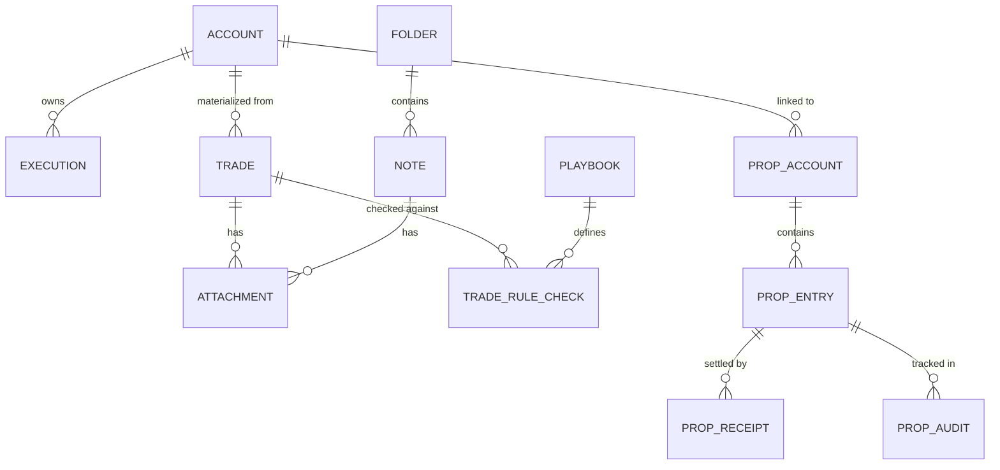

# MAPPING MÔ HÌNH NGHIỆP VỤ VÀ QUY TẮC TÀI CHÍNH (DOMAIN MAPPING)
**Dự án:** Trade Journal — iOS Native  
**Tài liệu tham chiếu:** `packages/core`, `packages/importers`, `apps/web/src/lib`

---

## 1. MÔ HÌNH DỮ LIỆU THỰC THỂ (DOMAIN ENTITIES)



### 1.1. Thực thể nguyên tử: `Execution` (Fills)
Là sự kiện kinh tế nền tảng (atomic fact) ghi lại một lần khớp lệnh tại sàn hoặc sao kê. Không bao giờ bị chỉnh sửa hoặc suy diễn bởi thuật toán phân tích.

- `id`: String (UUID v4 hoặc hash xác định).
- `account_id`: String (FK tới `accounts.id`).
- `symbol`: String (Mã tài sản, ví dụ: "AAPL", "EURUSD", "ES").
- `side`: "buy" | "sell".
- `quantity`: Số dương (Double/Decimal).
- `price`: Giá thực hiện trên 1 đơn vị.
- `fee`: Phí hoa hồng + phụ phí (giá trị tuyệt đối không âm).
- `executed_at`: ISO 8601 UTC timestamp.
- `asset_class`: "equity" | "option" | "futures" | "forex" | "crypto" | "cfd" | "other".
- `source`: "sync" | "import" | "manual".
- `import_metadata`: Chứa ID nguồn, nhóm vị thế (`group`), thứ tự file (`order`), và P&L báo cáo trước (`reportedGrossPnl`).
- `content_hash`: SHA-256 xác định nội dung để chống ghi trùng.

### 1.2. Thực thể dẫn xuất: `RoundTrip` / `Trade`
Chu kỳ vị thế từ khi mở trạng thái cho tới khi trạng thái quay về mức phẳng (Flat-to-Flat cycle: flat -> open -> flat).

- `key`: Khóa định danh duy nhất ổn định: `${accountId}|${symbol}|${direction}|${openedAt}[|import:${group}][|${collisionIndex}]`.
- `account_id`: String.
- `symbol`: String.
- `direction`: "long" | "short".
- `status`: "open" | "win" | "loss" | "breakeven".
- `opened_at`: Thời điểm execution đầu tiên mở chu kỳ.
- `closed_at`: Thời điểm execution đóng vị thế hoàn toàn (hoặc nil nếu còn mở).
- `quantity`: Tổng khối lượng vào lệnh tích lũy trong chu kỳ.
- `open_quantity`: Khối lượng còn đang mở (bằng 0 nếu đã đóng).
- `avg_entry`: Giá vào trung bình theo trọng số khối lượng: `sum(qty * price) / totalQty`.
- `avg_exit`: Giá thoát trung bình theo trọng số khối lượng.
- `gross_pnl`: Lãi/lỗ gộp trước phí.
- `fees`: Tổng phụ phí qua tất cả các executions thuộc chu kỳ.
- `net_pnl`: `gross_pnl - fees`.
- `execution_count`: Số lượng fills tạo nên trade.
- `execution_ids`: Danh sách IDs của các fills tham gia.
- `exits`: Danh sách ghi nhận P&L cho từng lần đóng một phần (`ExitAttribution`).
- `duration_ms`: Thời gian giữ lệnh (milliseconds).
- `annotations`: Thuộc tính ghi chú do người dùng nhập (tags, mistakes, playbook, rating, stopLoss, profitTarget, notes).

---

## 2. QUY TẮC TÁI DỰNG TRADE (ROUND-TRIP RECONSTRUCTION)

Thuật toán gốc nằm tại `packages/core/src/round-trips.ts`. Khi chuyển đổi sang Swift, thuật toán phải tuân thủ nghiêm ngặt các quy tắc sau:

### Quy tắc 2.1: Nhóm và sắp xếp thứ tự toàn phần (Deterministic Total Order)
Các executions được nhóm theo: `accountId + "\0" + symbol [ + "\0" + importGroup ]`.
Trong từng nhóm, danh sách bắt buộc phải được sắp xếp theo bộ ba tiêu chí để bảo đảm tính tất định:
1. `executedAt` tăng dần theo thời gian thực (epoch milliseconds).
2. `importMetadata.order` tăng dần (nếu có; fill không có order xếp sau cùng).
3. `id` so sánh chuỗi (locale-insensitive string compare) để phá vỡ thế hòa (tie-break).

### Quy tắc 2.2: Ngưỡng làm phẳng (Flat Threshold)
`FLAT_EPS = 1e-9`. Bất kỳ vị thế nào có giá trị tuyệt đối nhỏ hơn hoặc bằng `1e-9` đều được coi là phẳng (Flat). Điều này ngăn ngừa sai số tích lũy từ số thập phân nhỏ (fractional crypto dust).

### Quy tắc 2.3: Phân tách lệnh xuyên qua mức phẳng (Flat-Crossing Split)
Khi một lệnh thoát có khối lượng lớn hơn khối lượng đang mở của chu kỳ hiện tại:
1. Phần khối lượng bằng khối lượng đang mở sẽ dùng để **đóng hoàn toàn chu kỳ hiện tại**.
2. Phần khối lượng vượt mức sẽ **mở ra một chu kỳ mới** theo hướng ngược lại (đảo vị thế - position reversal).
3. Phí hoa hồng của lệnh được **phân bổ theo tỷ lệ khối lượng** (`fee * (exitQty / totalQty)`) cho chu kỳ đóng, phần còn lại chuyển sang chu kỳ mới.

### Quy tắc 2.4: Phân bổ lot vào và phương pháp tính lợi nhuận (ProfitCalcMethod)
- **FIFO (First-In, First-Out):** Lệnh thoát khớp trước với các lot vào sớm nhất.
- **LIFO (Last-In, First-Out):** Lệnh thoát khớp trước với các lot vào trễ nhất.
- **WAVG (Weighted Average):** Giá vào được tính theo trung bình trọng số toàn bộ vị thế đang mở tại thời điểm thoát.

> **Bất biến tài chính (Invariant):** Tổng `gross_pnl` và `net_pnl` của một chu kỳ đã hoàn thành là **hoàn toàn giống nhau** dưới cả 3 phương pháp FIFO, LIFO và WAVG. Sự khác biệt duy nhất là cách phân bổ P&L giữa các lần chốt lời từng phần (`exits`).

### Quy tắc 2.5: Trạng thái Trade (Status Determination)
```swift
if openQuantity > FLAT_EPS {
    status = .open
} else if abs(netPnl) <= 1e-9 {
    status = .breakeven
} else if netPnl > 0 {
    status = .win
} else {
    status = .loss
}
```

---

## 3. CÔNG THỨC CHỈ SỐ TÀI CHÍNH (METRICS FORMULAS)

Các công thức gốc tại `packages/core/src/metrics.ts` và `equity.ts`:

1. **Win Rate:**  
   $$\text{Win Rate} = \frac{\text{Số lệnh Win}}{\text{Số lệnh đã đóng (Win + Loss + Breakeven)}}$$
   *(Nếu không có lệnh nào đã đóng: trả về nil).*

2. **Profit Factor:**  
   $$\text{Gross Profit} = \sum_{t \in \text{Closed}} \max(0, t.\text{netPnl})$$
   $$\text{Gross Loss} = \sum_{t \in \text{Closed}} -\min(0, t.\text{netPnl})$$
   $$\text{Profit Factor} = \frac{\text{Gross Profit}}{\text{Gross Loss}}$$
   *(Nếu có Gross Profit > 0 và Gross Loss = 0: trả về nil và đánh dấu `profitFactorIsInfinite = true`).*

3. **Expectancy (Kỳ vọng toán học trên mỗi trade):**  
   $$\text{Expectancy} = \frac{\sum t.\text{netPnl}}{\text{Số lệnh đã đóng}}$$

4. **Max Drawdown (Độ sụt giảm tối đa):**  
   Độ chênh lệch sâu nhất giữa đỉnh vốn lũy kế (`Peak`) và đáy vốn sau đỉnh (`Trough`):
   $$\text{Drawdown} = \text{Running Peak} - \text{Current Cumulative Equity}$$
   $$\text{Max Drawdown \%} = \frac{\text{Max Drawdown}}{\text{Initial Balance} + \text{Peak At That Point}}$$

5. **Day Win Rate:**  
   $$\text{Day Win Rate} = \frac{\text{Số ngày có Net P&L} > 0}{\text{Tổng số ngày có phát sinh giao dịch}}$$

6. **Edge Score v2 (0 — 100):**  
   Bao gồm 6 thành phần với trọng số cố định:
   - `winRate` (Trọng số 15): Điểm tối đa khi Win Rate đạt $\ge 60\%$.
   - `profitFactor` (Trọng số 25): Điểm tối đa khi Profit Factor $\ge 3.0$.
   - `avgWinLoss` (Trọng số 20): Điểm tối đa khi Tỷ lệ Thắng/Thua $\ge 2.5 : 1$.
   - `drawdown` (Trọng số 15): Tuyến tính từ 0% sụt giảm (100 điểm) đến $\ge 25\%$ (0 điểm).
   - `recovery` (Trọng số 10): Điểm tối đa khi Net P&L $\ge 3 \times \text{Max Drawdown}$.
   - `consistency` (Trọng số 15): Điểm tối đa khi ngày thắng lớn nhất chiếm $\le 15\%$ tổng lợi nhuận ngày.

---

## 4. QUY TẮC ĐỘ CHÍNH XÁC SỐ HỌC (NUMERICAL PRECISION)

- Toàn bộ các phép tính tiền tệ trong Swift Engine phải sử dụng kiểu `Decimal` của Foundation. Tuyệt đối không dùng kiểu `Double` để tính tổng tiền hoặc P&L lũy kế nhằm tránh sai số nhị phân (`0.1 + 0.2 = 0.30000000000000004`).
- Đối với phân hệ Prop Firm Tracker: Lưu trữ toàn bộ số tiền dưới dạng số nguyên `Int64` biểu diễn đơn vị nhỏ nhất (minor units, ví dụ: 100 USD = 10,000 cents). Tỷ lệ chia thưởng dùng basis points (`splitBps`, ví dụ: 80% = 8,000 bps).
