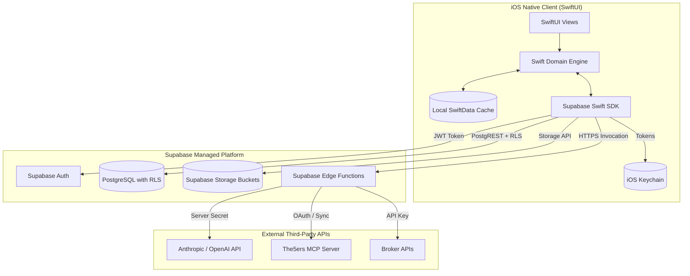

# THIẾT KẾ KIẾN TRÚC SUPABASE BACKEND (SUPABASE ARCHITECTURE)
**Dự án:** Trade Journal — Native iOS  
**Nền tảng backend duy nhất:** Supabase (Auth, PostgreSQL, Storage, Edge Functions)

---

## 1. TỔNG QUAN KIẾN TRÚC BACKEND



---

## 2. XÁC THỰC NGƯỜI DÙNG (SUPABASE AUTH)

- **Phương thức:** Email & Mật khẩu (hỗ trợ thêm Sign in with Apple theo tiêu chuẩn App Store).
- **Quản lý Token:** Supabase Swift SDK tự động cấp phát `access_token` (JWT) và `refresh_token`.
- **Lưu trữ an toàn:** Lưu `refresh_token` trong **iOS Keychain Services** với cờ bảo mật `kSecAttrAccessibleAfterFirstUnlockThisDeviceOnly`. Tuyệt đối không lưu token vào `UserDefaults` hoặc file không mã hóa.
- **Vòng đời phiên:**
  - Tự động làm mới token trước khi hết hạn (refresh token cycle).
  - Khi token hết hạn hoặc người dùng đổi mật khẩu, ứng dụng chuyển về màn hình đăng nhập an toàn, xóa cache cục bộ tương ứng.
  - Hỗ trợ làm việc offline với dữ liệu đã lưu trong SwiftData khi mất mạng.

---

## 3. CƠ SỞ DỮ LIỆU POSTGRESQL VÀ ROW LEVEL SECURITY (RLS)

### 3.1. Nguyên tắc bổ sung `user_id` (Multi-tenancy)
Toàn bộ các bảng trong `schema.pg.ts` của source gốc chưa có cột `user_id`. Trong kiến trúc mới, **100% các bảng thuộc quyền sở hữu của người dùng** phải có cột:
```sql
user_id UUID NOT NULL DEFAULT auth.uid() REFERENCES auth.users(id) ON DELETE CASCADE
```

### 3.2. Danh sách bảng và quan hệ
1. `accounts`: Danh sách tài khoản giao dịch (broker, kind, currency, initial_balance, profit_calc_method).
2. `import_sources` & `import_source_aliases`: Nguồn nhập và bí danh tài khoản.
3. `import_batches`: Lịch sử các đợt nhập file (fingerprint, hash, timezone, snapshot).
4. `executions`: Các lần khớp lệnh nguyên tử (`symbol`, `side`, `quantity`, `price`, `fee`, `executed_at`, `content_hash`).
   - Khóa duy nhất chống trùng: `UNIQUE (user_id, account_id, content_hash)`.
5. `trades`: Bảng dẫn xuất các chu kỳ lệnh flat-to-flat (`key`, `direction`, `status`, `opened_at`, `closed_at`, `net_pnl`, annotations).
   - Khóa chính: `(user_id, key)`.
6. `journal_days`: Ghi chú nhật ký theo ngày (`date`, `note`, `updated_at`).
7. `folders` & `notes`: Cấu trúc thư mục ghi chú dạng cây và nội dung note markdown.
8. `playbooks` & `trade_rule_checks`: Chiến lược mẫu và việc tuân thủ quy tắc trên từng trade.
9. `progress_rules` & `progress_checks`: Quy tắc thói quen và checklist hàng ngày.
10. `missed_trades`: Cơ hội giao dịch bị bỏ lỡ.
11. `prop_accounts`, `prop_entries`, `prop_receipts`, `prop_audit`: Toàn bộ sổ cái tiền mặt Prop Firm.
12. `settings`: Cấu hình người dùng dạng Key-Value (`user_id`, `key`, `value`).
13. `attachments`: Metadata file đính kèm (`storage_path`, `mime`, `size`, `owner_type`, `owner_id`).
14. `market_csv_datasets` & `trade_excursions`: Dữ liệu nến thị trường và ước tính MAE/MFE.

### 3.3. Chính sách Row Level Security (RLS) mẫu
Áp dụng trên mọi bảng để bảo đảm dữ liệu của User A tuyệt đối không thể bị User B đọc hoặc chỉnh sửa:
```sql
-- Ví dụ trên bảng accounts
ALTER TABLE accounts ENABLE ROW LEVEL SECURITY;

CREATE POLICY "Users can only read own accounts"
ON accounts FOR SELECT
USING (auth.uid() = user_id);

CREATE POLICY "Users can only insert own accounts"
ON accounts FOR INSERT
WITH CHECK (auth.uid() = user_id);

CREATE POLICY "Users can only update own accounts"
ON accounts FOR UPDATE
USING (auth.uid() = user_id)
WITH CHECK (auth.uid() = user_id);

CREATE POLICY "Users can only delete own accounts"
ON accounts FOR DELETE
USING (auth.uid() = user_id);
```

---

## 4. LƯU TRỮ TỆP TIN (SUPABASE STORAGE)

Hai private bucket được khởi tạo:
1. `journal-attachments`: Lưu ảnh chụp màn hình biểu đồ (chart screenshots), hóa đơn phí quỹ, sao kê PDF.
   - Đường dẫn: `${user_id}/${owner_type}/${owner_id}/${uuid}.${ext}`
2. `market-data`: Lưu trữ các file CSV nến lịch sử được upload để phân tích và replay.
   - Đường dẫn: `${user_id}/datasets/${dataset_id}.csv`

**Chính sách truy cập Storage:**
Chỉ cho phép đọc/ghi khi đường dẫn tệp bắt đầu bằng UUID của chính user đó (`(storage.foldername(name))[1] = auth.uid()::text`).

---

## 5. SUPABASE EDGE FUNCTIONS (SERVER-SIDE HANDLERS)

Chỉ sử dụng Edge Functions cho các trường hợp đặc biệt theo quy định tại Section 2.1 của Master Plan:

1. **`ai-reflection`**:
   - Mục đích: Xử lý các yêu cầu AI Ask, Trade Critique, và Day Recap.
   - Lý do kỹ thuật: Giữ kín API key của Anthropic/OpenAI trên server (R005). Không nhúng key vào binary app iOS.
   - Luồng: Client gửi JWT token + payload ngữ cảnh -> Edge function xác thực JWT -> Lấy secret API key từ environment -> Gửi tới AI provider -> Trả về câu trả lời định dạng text/markdown.

2. **`broker-sync` (Tùy chọn)**:
   - Mục đích: Hỗ trợ fetch dữ liệu từ broker khi cần bảo vệ credentials bí mật hoặc điều phối webhook.

---

## 6. POSTGRESQL RPC FUNCTIONS (ATOMIC TRANSACTIONS)

Để đảm bảo tính nguyên tử khi nạp hàng loạt executions và tính toán lại trade mà không bị mất dữ liệu giữa chừng:
- Xây dựng PostgreSQL Function `bulk_insert_executions_and_rebuild(...)` nhận batch executions, kiểm tra hash chống trùng, thêm bản ghi mới và cập nhật trạng thái bảng `trades` trong cùng một transaction của database.
