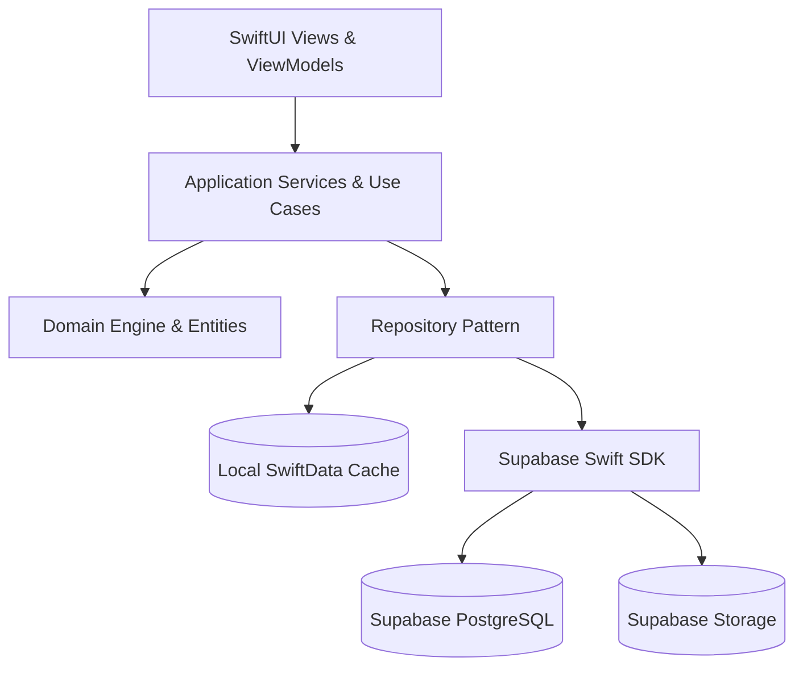

# THIẾT KẾ KIẾN TRÚC ỨNG DỤNG NATIVE IOS (IOS ARCHITECTURE)
**Dự án:** Trade Journal — Native iOS Application  
**Công nghệ:** Swift 5.10 / Swift 6, SwiftUI, SwiftData, Swift Concurrency, Swift Charts, Supabase Swift SDK

---

## 1. CÁC TẦNG KIẾN TRÚC (ARCHITECTURAL LAYERS)

Ứng dụng được xây dựng theo mô hình **Clean Architecture kết hợp MVVM** phân tách rõ ràng trách nhiệm giữa các tầng:



### 1.1. Tầng Trình diễn (Presentation Layer - SwiftUI)
- **SwiftUI Pure Native:** 100% giao diện viết bằng SwiftUI, không sử dụng WKWebView cho các màn hình nghiệp vụ chính.
- **Biểu đồ tài chính:** Tận dụng **Swift Charts** để dựng các biểu đồ hiệu năng cao, mượt mà:
  - Đường cong vốn (Equity Curve).
  - Biểu đồ Drawdown chìm dưới nước (Underwater Chart).
  - Phân bổ P&L theo ngày, giờ, phiên giao dịch (Session Distribution).
  - Biểu đồ nến kỹ thuật và thanh trượt phát lại (Trade Replay).
- **Trạng thái giao diện:** Chuẩn hóa 4 trạng thái cho mọi màn hình: Loading, Empty, Success, Error (kèm nút Retry).

### 1.2. Tầng Ứng dụng & Điều phối (Application / Use Cases)
- Đóng gói các luồng nghiệp vụ người dùng: `ImportStatementUseCase`, `RebuildAccountUseCase`, `SyncDataUseCase`, `CalculateMetricsUseCase`.
- Sử dụng **Swift Concurrency (`async`/`await`, `Task`, `Actor`)** để xử lý đa luồng, đảm bảo toàn bộ phép tính toán nặng không bao giờ chặn Main Thread.

### 1.3. Tầng Nghiệp vụ Lõi (Domain Engine Layer)
- Là mã Swift thuần (Pure Swift), độc lập hoàn toàn với framework UI và database.
- Bao gồm:
  - `TradeReconstructionEngine`: Port từ `round-trips.ts`.
  - `FinancialMetricsEngine`: Port từ `metrics.ts` & `equity.ts`.
  - `EdgeScoreEngine`: Port từ `edge-score.ts` (Edge Score v2).
  - `PropLedgerEngine`: Port từ `lib/prop-firms.ts`.
  - `ImportersEngine`: Bộ parser phân tích CSV/HTML từ 13 định dạng sàn.

### 1.4. Tầng Dữ liệu & Lưu trữ (Data & Persistence Layer)
- **Repository Pattern:** `TradeRepository`, `AccountRepository`, `JournalRepository`, `PropFirmRepository`.
- **Nguồn dữ liệu cục bộ (Local Store):** Sử dụng **SwiftData** (hoặc SQLite thuần) làm cache offline và lưu trữ hàng đợi thao tác chờ đồng bộ.
- **Nguồn dữ liệu từ xa (Remote Store):** Supabase Swift SDK kết nối PostgREST API với phân quyền RLS.

---

## 2. CẤU TRÚC THƯ MỤC DỰ ÁN (PROJECT DIRECTORY STRUCTURE)

```
TradeJournal/
├── App/
│   ├── TradeJournalApp.swift       # Entry point của ứng dụng
│   ├── AppEnvironment.swift         # Dependency Container & Môi trường (Debug/Release)
│   └── AppRouter.swift              # Quản lý điều hướng toàn app
├── DesignSystem/
│   ├── Theme/                       # Màu sắc, Dark/Light mode tokens
│   ├── Typography/                  # Font chữ, Heading styles
│   ├── Components/                  # Buttons, Cards, Badges, Modals, Input fields
│   ├── Charts/                      # Reusable Swift Charts components
│   └── Formatting/                  # Formatters: Currency, Percentage, Date/Time
├── Core/
│   ├── Domain/
│   │   ├── Models/                  # Execution, RoundTrip, Trade, Account, PropEntry
│   │   ├── Invariants/              # Financial rules, Status definitions
│   │   └── Engines/                 # TradeEngine, MetricsEngine, EdgeScoreEngine
│   ├── Application/
│   │   └── UseCases/                # Import, Sync, Rebuild, Export
│   ├── Data/
│   │   ├── Repositories/            # Implementations of Domain Repositories
│   │   └── DTOs/                    # Data Transfer Objects cho Supabase API
│   ├── Networking/
│   │   ├── SupabaseClientManager.swift
│   │   └── NetworkMonitor.swift     # Theo dõi trạng thái Wi-Fi/Cellular
│   ├── Persistence/
│   │   └── SwiftDataModels/         # SDAccount, SDExecution, SDTrade, SDNote
│   ├── Synchronization/
│   │   ├── SyncCoordinator.swift    # Điều phối tiến trình đồng bộ
│   │   ├── PendingQueue.swift       # Hàng đợi thao tác offline
│   │   └── ConflictResolver.swift   # Xử lý xung đột dữ liệu
│   └── Security/
│       └── KeychainManager.swift    # Lưu trữ Token và User Secrets an toàn
├── Features/
│   ├── Authentication/              # Login, Register, Session Restore
│   ├── Dashboard/                   # Overview, Equity Curve, Edge Score Card
│   ├── Accounts/                    # Danh sách và chi tiết tài khoản
│   ├── Trades/                      # Danh sách trade, Bộ lọc, Chi tiết lệnh
│   ├── Import/                      # File Picker, Parser, Preview, Batch Commit
│   ├── Analytics/                   # Reports, R-multiples, Phân tích phiên
│   ├── Journal/                     # Lịch P&L, Ghi chú ngày, Markdown Editor
│   ├── Notebook/                    # Quản lý thư mục & Notes
│   ├── Playbooks/                   # Setup mẫu & Checklist quy tắc
│   ├── PropFirm/                    # Sổ cái tài chính Quỹ (Spend, Payouts, ROI)
│   ├── MarketData/                  # Nạp nến CSV, Trade Replay, MAE/MFE
│   ├── AIReflection/                # Ask Journal, Trade Critique, Day Recap
│   └── Settings/                    # Múi giờ, Chế độ riêng tư, Export backup
└── Resources/
    ├── Assets.xcassets
    └── Localizations/
```

---

## 3. MÔ HÌNH BẢO MẬT TRÊN THIẾT BỊ (SECURITY ON DEVICE)

1. **Keychain Services:**
   Lưu trữ `access_token`, `refresh_token`, và `user_id` vào iOS Keychain với thuộc tính bảo vệ cấp cao nhất:
   `kSecAttrAccessibleAfterFirstUnlockThisDeviceOnly`.
2. **Không lưu trữ bí mật trong App Bundle:**
   Không lưu bất kỳ API Key nào của OpenAI, Anthropic, hay Supabase Service Role Key trong binary hoặc mã nguồn iOS.
3. **Chế độ riêng tư (Privacy Mode):**
   Tích hợp chế độ làm mờ số dư tài khoản và số tiền lãi/lỗ khi mở app ở nơi công cộng (áp dụng cho toàn bộ view và widget).
