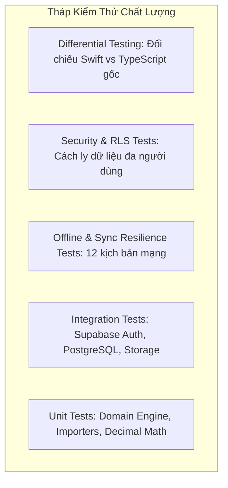

# CHIẾN LƯỢC KIỂM THỬ VÀ ĐỐI CHIẾU NGHIỆP VỤ (TEST STRATEGY)
**Dự án:** Trade Journal — iOS Native  
**Mục tiêu:** Đảm bảo độ tin cậy tuyệt đối về mặt tài chính và bảo mật thông qua đa tầng kiểm thử.

---

## 1. MÔ HÌNH CÁC TẦNG KIỂM THỬ

---

## 2. UNIT TESTS (KIỂM THỬ ĐƠN VỊ NGHIỆP VỤ)

Sử dụng framework **Swift Testing** (hoặc XCTest) cho các module thuần Swift:

1. **Trade Reconstruction (`TradeEngineTests`):**
   - Vị thế Long đơn giản (Buy -> Sell full).
   - Vị thế Short đơn giản (Sell -> Buy full).
   - Vị thế chưa đóng (Open trade, `openQuantity > 0`, `avgExit == nil`).
   - Lệnh đảo chiều xuyên qua mức phẳng (Crossing flat split, chia phí theo tỷ lệ).
   - Ghép lot FIFO, LIFO, WAVG cho các vị thế đóng từng phần (Partial exits).
   - Tính toán với hệ số nhân hợp đồng (Contract Multiplier cho Futures/Options).
   - Khắc phục xung đột khóa định danh (Key collision index).

2. **Chỉ số hiệu suất (`MetricsEngineTests`):**
   - Tính toán Win Rate, Day Win Rate, Expectancy, Profit Factor.
   - Xử lý trường hợp đặc biệt: Tài khoản chỉ có lệnh thắng (`profitFactorIsInfinite = true`).
   - Tính toán Max Drawdown và Relative Drawdown Curve.
   - Thống kê chuỗi thắng/thua liên tiếp (`streaks`).

3. **Chỉ số Edge Score v2 (`EdgeScoreTests`):**
   - Đảm bảo 6 thành phần điểm số được chuẩn hóa chính xác theo thang 0 - 100.
   - Đối chiếu trọng số: `winRate: 15`, `profitFactor: 25`, `avgWinLoss: 20`, `drawdown: 15`, `recovery: 10`, `consistency: 15`.

4. **Bộ phân tích sao kê (`ImporterTests`):**
   - Nhận diện đúng 13 định dạng sao kê (`detectFormat`).
   - Xử lý các định dạng ngày tháng có múi giờ, định dạng số có dấu phẩy/chấm, số âm trong ngoặc đơn `(100.00)`.

---

## 3. DIFFERENTIAL TESTING (KIỂM THỬ ĐỐI CHIẾU NGUYÊN BẢN)

Để tuân thủ tuyệt đối nguyên tắc **R003 — Không làm sai dữ liệu tài chính**, toàn bộ các bộ dữ liệu mẫu (fixtures) từ `packages/core/tests` và file sao kê thực tế sẽ được đưa qua cả 2 engine:

1. **Engine 1 (Bản gốc):** Chạy bằng Node.js / TypeScript (`packages/core`).
2. **Engine 2 (Bản port):** Chạy bằng Swift (`TradeEngine`).

### Các trường bắt buộc so sánh:
- `key`: Khóa định danh trade.
- `direction`: Long / Short.
- `status`: Open / Win / Loss / Breakeven.
- `quantity` & `openQuantity`.
- `avgEntry` & `avgExit`.
- `grossPnl`, `fees`, `netPnl` (Sai số cho phép: $\le 10^{-6}$).
- `durationMs`.
- `winRate`, `profitFactor`, `expectancy`, `maxDrawdown`.

> **Tiêu chuẩn nghiệm thu:** Không được có bất kỳ sai lệch nào chưa giải thích được giữa bản gốc và bản Swift.

---

## 4. KIỂM THỬ ĐỒNG BỘ VÀ KHẢ NĂNG PHỤC HỒI (OFFLINE & SYNC RESILIENCE)

12 kịch bản bắt buộc theo Master Plan 13.4:
1. Tạo ghi chú / chỉnh sửa trade khi đang Online -> Dữ liệu cập nhật ngay trên Supabase.
2. Tạo dữ liệu khi Offline (ngắt mạng) -> Lưu thành công vào hàng đợi SwiftData.
3. Đóng ứng dụng hoàn toàn khi đang Offline.
4. Mở lại ứng dụng và khôi phục mạng -> Hàng đợi tự động flush lên Supabase.
5. Thử lại tự động sau khi bị Timeout mạng -> Không sinh bản ghi trùng.
6. Thử lại sau khi Server báo lỗi 500 -> Exponential backoff hoạt động đúng.
7. Hai thiết bị cùng chỉnh sửa ghi chú một trade khi offline -> Chính sách giải quyết xung đột không làm mất dữ liệu.
8. Thiết bị A xóa một trade, thiết bị B đang giữ cache -> Thiết bị B cập nhật xóa bản ghi khi đồng bộ.
9. Nhập lại cùng một file CSV nhiều lần -> Số lượng bản ghi mới bằng 0, không nhân đôi executions.
10. Mất mạng đột ngột giữa quá trình nạp batch execution -> Transaction rollback hoặc tiếp tục an toàn ở batch sau.
11. Hết hạn phiên đăng nhập giữa lúc đang đồng bộ -> Ứng dụng refresh token tự động hoặc yêu cầu đăng nhập lại an toàn.
12. Dữ liệu trên server thay đổi từ thiết bị khác trong lúc iPhone offline -> Dữ liệu mới được tải về khi online.

---

## 5. SECURITY TESTING (KIỂM THỬ BẢO MẬT & RLS)

Bộ test tự động kiểm tra quyền dữ liệu giữa 2 người dùng độc lập (User A và User B):
- User A **không thể đọc** bất kỳ tài khoản, execution, trade, ghi chú nào của User B (`SELECT` trả về rỗng).
- User A **không thể sửa** dữ liệu của User B (`UPDATE` không ảnh hưởng dòng nào).
- User A **không thể xóa** dữ liệu của User B (`DELETE` không ảnh hưởng dòng nào).
- User A **không thể truy cập** file đính kèm trong Storage của User B.
- Kiểm tra mã nguồn và binary ipa: **Không có bất kỳ Secret Key hoặc Service Role Key nào** được nhúng vào ứng dụng.
