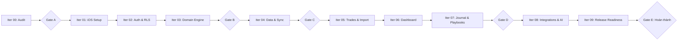

# KẾ HOẠCH TRIỂN KHAI THEO TỪNG ITERATION (IMPLEMENTATION PLAN)
**Dự án:** Trade Journal — Native iOS + Supabase  
**Nguyên tắc:** Triển khai theo từng iteration nhỏ, kiểm chứng bằng test, có tiêu chí nghiệm thu rõ ràng tại mỗi Gate.

---

## 1. LỘ TRÌNH VÀ CÁC GATE NGHIỆM THU

---

## 2. KẾ HOẠCH CHI TIẾT TỪNG ITERATION

### Iteration 00 — Source Audit & Architecture Design (ĐANG THỰC HIỆN)
- **Mục tiêu:** Hiểu toàn diện source code, data model, API, thuật toán tính toán và các tích hợp; xác định kiến trúc Supabase và iOS Native.
- **Sản phẩm bàn giao:** Bộ 11 tài liệu hoàn chỉnh trong `docs/ios/` và báo cáo audit.
- **Tiêu chí nghiệm thu (Gate A):** Đầy đủ tài liệu, xác định rõ các rủi ro, quy tắc nghiệp vụ không bị suy đoán bừa bãi.

### Iteration 01 — iOS Project Setup & Foundation
- **Mục tiêu:** Khởi tạo project Xcode Native, cấu hình Swift version, Swift Concurrency, dependency management, thiết kế Design System cơ sở.
- **Phạm vi triển khai:**
  - Cấu hình targets: `TradeJournalApp`, `TradeJournalTests`.
  - Design Tokens: Colors (Dark/Light mode), Typography, Theme.
  - Base components: Buttons, Input fields, Card, Badge, Error/Loading states.
  - Dependency Container & AppRouter.
- **Tiêu chí nghiệm thu:** Build thành công, chạy được trên Simulator/thiết bị, test target hoạt động.

### Iteration 02 — Authentication & Security
- **Mục tiêu:** Tích hợp Supabase Auth, thiết lập Keychain an toàn, triển khai RLS trên Supabase PostgreSQL.
- **Phạm vi triển khai:**
  - Luồng Đăng nhập, Đăng ký, Đăng xuất, Khôi phục phiên.
  - Lưu `refresh_token` an toàn trong iOS Keychain Services.
  - Tạo Supabase Migration SQL cho RLS và cột `user_id`.
  - Security tests kiểm tra cách ly đa người dùng (User A vs User B).
- **Tiêu chí nghiệm thu:** Người dùng đăng nhập được, dữ liệu riêng tư được bảo vệ 100% bằng RLS.

### Iteration 03 — Domain Engine & Financial Parity
- **Mục tiêu:** Port toàn bộ engine tính toán từ TypeScript sang Swift thuần, sử dụng `Decimal`.
- **Phạm vi triển khai:**
  - `TradeReconstructionEngine`: Flat-to-flat, FIFO/LIFO/WAVG, crossing flat split.
  - `FinancialMetricsEngine`: Win rate, profit factor, drawdown, expectancy, streaks.
  - `EdgeScoreEngine`: Tính điểm Edge Score v2 chuẩn 6 thành phần.
  - Bộ test Differential Testing so sánh kết quả 1:1 với bản gốc.
- **Tiêu chí nghiệm thu (Gate B):** 100% unit tests và differential tests pass, không có sai lệch chưa giải thích.

### Iteration 04 — Data Layer & Synchronization
- **Mục tiêu:** Xây dựng tầng lưu trữ cục bộ SwiftData và Engine đồng bộ hai chiều với Supabase.
- **Phạm vi triển khai:**
  - SwiftData Schema (`SDAccount`, `SDExecution`, `SDTrade`, `SDNote`).
  - `PendingQueue` lưu thao tác ngoại tuyến.
  - `SyncCoordinator` xử lý đồng bộ tăng dần và giải quyết xung đột (Conflict Resolution).
  - Test 12 kịch bản mạng và offline resilience.
- **Tiêu chí nghiệm thu (Gate C):** Thao tác offline được đồng bộ khi có mạng, retry không tạo trùng lặp dữ liệu.

### Iteration 05 — Accounts, Trades & Import Pipeline
- **Mục tiêu:** Quản lý tài khoản giao dịch, danh sách/chi tiết trade, và bộ phân tích sao kê file CSV/HTML.
- **Phạm vi triển khai:**
  - Màn hình Quản lý tài khoản.
  - Màn hình Danh sách Trades (lọc theo ngày, symbol, direction, status) và Chi tiết Trade.
  - Màn hình Import: File picker, nhận diện định dạng tự động, màn hình Preview và xác nhận nạp.
  - Cơ chế băm SHA-256 chống trùng và tự động kích hoạt rebuild trades.
- **Tiêu chí nghiệm thu:** Nhập thành công các file sao kê mẫu, phát hiện đúng file lỗi và file trùng.

### Iteration 06 — Dashboard & Analytics
- **Mục tiêu:** Hiển thị trang tổng quan trực quan và các báo cáo phân tích hiệu suất chuyên sâu.
- **Phạm vi triển khai:**
  - Biểu đồ vốn (Equity Curve) và Underwater Drawdown bằng Swift Charts.
  - Thẻ hiển thị Edge Score v2 và các chỉ số tài chính chủ chốt.
  - Màn hình Reports: Phân tích theo phiên giao dịch, thứ trong tuần, R-multiple.
  - Lịch giao dịch P&L theo ngày/tháng (Calendar view).
- **Tiêu chí nghiệm thu:** Số liệu dashboard khớp tuyệt đối với kết quả tính toán của engine.

### Iteration 07 — Journal, Playbooks, Routines & Replay
- **Mục tiêu:** Quản lý nhật ký cá nhân, chiến lược giao dịch và phát lại biểu đồ.
- **Phạm vi triển khai:**
  - Màn hình Nhật ký theo ngày, trình soạn thảo Markdown, đính kèm ảnh (Supabase Storage).
  - Quản lý Playbooks và checklist tuân thủ quy tắc cho từng trade.
  - Kỷ luật giao dịch (Progress rules) và theo dõi cơ hội bỏ lỡ (Missed trades).
  - Trade Replay: Xem nến lịch sử và di chuyển thanh trượt mô phỏng diễn biến lệnh.
- **Tiêu chí nghiệm thu (Gate D):** Ghi chú đồng bộ mượt mà, lưu ảnh an toàn trong Storage bucket.

### Iteration 08 — Integrations: Prop Firm Ledger, The5ers, Broker Sync & AI
- **Mục tiêu:** Tích hợp sổ cái Quỹ, các kết nối bên thứ ba và tính năng AI Reflection.
- **Phạm vi triển khai:**
  - Phân hệ Prop Firm Ledger: Quản lý chi phí, yêu cầu rút thưởng, tính ROI bằng số nguyên minor units.
  - Tích hợp The5ers MCP qua OAuth PKCE / Supabase Edge Function.
  - Triển khai Supabase Edge Function `ai-reflection` cho các chức năng Ask, Critique, Recap.
- **Tiêu chí nghiệm thu:** Sổ cái quỹ chính xác đến từng cent, gọi AI thành công qua Edge Function bảo mật.

### Iteration 09 — Settings, Backup, Performance & Release Readiness
- **Mục tiêu:** Cài đặt hệ thống, tối ưu hiệu năng, xuất bản dữ liệu và nghiệm thu toàn diện.
- **Phạm vi triển khai:**
  - Cài đặt múi giờ, chế độ riêng tư ẩn số dư, xuất dữ liệu toàn bộ ra file JSON/CSV.
  - Tối ưu bộ nhớ, kiểm tra rò rỉ RAM (Leaks), kiểm tra độ mượt 60/120fps trên thiết bị thật.
  - Đóng gói ứng dụng, hoàn thiện tài liệu bàn giao.
- **Tiêu chí nghiệm thu (Gate E):** Ứng dụng sẵn sàng phát hành, đáp ứng toàn bộ các nguyên tắc bất biến R001 - R010.
